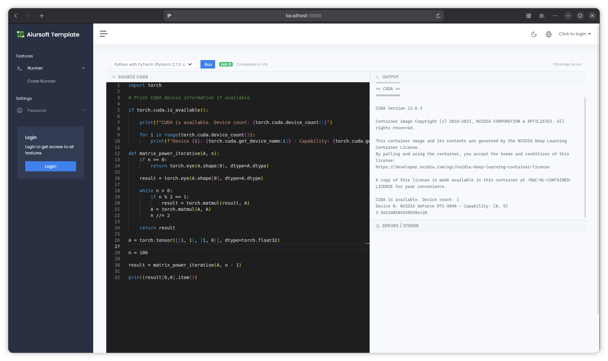

# Aiursoft CppRunner

<a name="cpprunner"></a>

[](https://github.com/aiursoftweb/cppRunner/blob/master/LICENSE)
[](https://gitlab.aiursoft.com/aiursoft/cppRunner/-/pipelines)
[](https://gitlab.aiursoft.com/aiursoft/cppRunner/-/pipelines)
[](https://s360.aiursoft.com/SupplyChain?tab=projects&project=aiursoft%2Fcpprunner&scope=baseline&ecosystem=all)
[](https://manhours.aiursoft.com/r/github.com/aiursoftweb/cppRunner.html)
[](https://cpprunner.aiursoft.com)
[](https://hub.docker.com/r/aiursoft/cpprunner)

CppRunner is a code runner on the web. It is designed to run C++ code snippets and provide a simple interface for users to test their code online.



Default user name is `admin@default.com` and default password is `Admin@123456!`.

## Overview

### What is CppRunner?

CppRunner is a code runner on the web. It is designed to run C++ code snippets and provide a simple interface for users to test their code online.

## Try

Try a running CppRunner [here](https://cppRunner.aiursoft.com).

## Install with Docker

Run the installer with the desired port (omit it to choose an available port):

```bash
curl -fsSL https://raw.githubusercontent.com/aiursoftweb/cpprunner/master/install.sh | sudo bash -s -- 8080
```

Installation starts after three seconds; press Ctrl+C to cancel. Then open `http://localhost:8080`.

## Run manually

Requirements about how to run

1. Install [.NET 10 SDK](http://dot.net/) and [Node.js](https://nodejs.org/).
2. Execute `npm install` at `wwwroot` folder to install the dependencies.
3. Execute `dotnet run` to run the app.
4. Use your browser to view [http://localhost:5000](http://localhost:5000).

## Run in Microsoft Visual Studio

1. Open the `.sln` file in the project path.
2. Press `F5` to run the app.

## Run in Docker

First, install Docker [here](https://docs.docker.com/get-docker/).

Then run the following commands in a Linux shell:

```bash
image=aiursoft/cpprunner
appName=cpprunner
sudo docker pull $image
sudo docker run -d --name $appName --restart unless-stopped -p 5000:5000 -v /var/www/$appName:/data -v /tmp/cpprunner:/tmp/cpprunner -v /var/run/docker.sock:/var/run/docker.sock $image
```

That will start a web server at `http://localhost:5000` and you can test the app.

The docker image has the following context:

| Properties  | Value                           |
|-------------|---------------------------------|
| Image       | aiursoft/cpprunner              |
| Ports       | 5000                            |
| Binary path | /app                            |
| Data path   | /data                           |
| Config path | /data/appsettings.json          |
| Passthrough path | /tmp          |

## Usage

### Authenticated Docker registry

CppRunner pulls language runtime images during application startup. Configure a private registry in
`DockerImageSettings` when those images require authentication:

```json
"DockerImageSettings": {
  "Prefix": "hub.aiursoft.com/",
  "RequireAuthentication": true,
  "Username": "your-user-name",
  "Password": ""
}
```

Provide the password through the `DockerImageSettings__Password` environment variable in production.
When authentication is enabled, CppRunner runs `docker login` with `--password-stdin` before inspecting
or pulling any images. The registry host is taken from `Prefix`; a prefix such as
`hub.aiursoft.com/public_mirror/` logs in to `hub.aiursoft.com`.

## Configuration

The application defaults are defined in [`src/Aiursoft.CppRunner/appsettings.json`](src/Aiursoft.CppRunner/appsettings.json). The Docker image initializes `/data/appsettings.json` on its first start and keeps it for later starts; persist `/data`. Override nested values with double-underscore environment variables, such as `Logging__LogLevel__Default`.

```jsonc
{
  "ConnectionStrings": {
    "AllowCache": "True",

    "DbType": "Sqlite",
    "DefaultConnection": "DataSource=app.db;Cache=Shared"

    // sudo docker run -d --name db -e MYSQL_RANDOM_ROOT_PASSWORD=true -e MYSQL_DATABASE=template -e MYSQL_USER=template -e MYSQL_PASSWORD=template_password -p 3306:3306 hub.aiursoft.com/mysql
    //"DbType": "MySql",
    //"DefaultConnection": "Server=localhost;Database=template;Uid=template;Pwd=template_password;"
  },
  "Storage": {
    "Path": "/tmp/data",
    "PublicOrigin": "",
    "RequireDedicatedInlineOrigin": false,
    "AllowArbitraryInlineOnDedicatedOrigin": false,
    "SafeInlineMediaExtensions": ["svg"],
    "SafeInlineSvgSubfolders": ["project-logo"],
    "UploadPolicy": {
      "RequireAuthenticatedUser": false,
      "ReplaceSpacesWithHyphens": false
    }
  },
  "AppSettings": {
    "AuthProvider": "Local", // OIDC or Local
    "DefaultRole": "",
    "PersistsSignIn": false,
    "OIDC": {
      // https://auth.aiursoft.com/application/o/template
      "Authority": "https://auth.aiursoft.com/application/o/template",
      "ClientId": "",
      "ClientSecret": "",
      "RolePropertyName": "groups",
      "UsernamePropertyName": "preferred_username",
      "UserDisplayNamePropertyName": "name",
      "EmailPropertyName": "email",
      "UserIdentityPropertyName": "sub"
    },
    "Local": {
      "AllowRegister": true,
      "AllowWeakPassword": true
    }
  },
  "GlobalSettings": {
    // You can initialize or override global settings here.
    // "Allow_User_Adjust_Nickname": "True",
    // "BrandName": "Aiursoft",
    // "BrandHomeUrl": "https://www.aiursoft.com/",
    // "Icp": "",
    // "ProjectName": "Aiursoft Template"
  },
  "Logging": {
    "LogLevel": {
      "Default": "Information",
      "Microsoft.AspNetCore": "Warning"
    },
    "Clickhouse": {
      "Enabled": false,
      "ConnectionString": "Host=localhost;Protocol=http;Port=8123;User=default;Password=;Database=AspNetCoreLogs",
      "TableName": "CppRunnerLogs"
    }
  },
  "AllowedHosts": "*",
  "DockerImageSettings": {
    "Prefix": "", // e.g. "hub.aiursoft.com/" to pull images from a private registry
    "RequireAuthentication": false,
    "Username": "",
    "Password": "" // Prefer DockerImageSettings__Password in production instead of storing the password here.
  }
}
```

### Shared settings

- `ConnectionStrings` selects the database provider and connection. Prepare the external database before choosing MySQL; keep the SQLite file persistent when using SQLite.
- `Storage` configures local application files. Keep the storage directory persistent and use the documented hostname and upload policies for shared downloads.
- `AppSettings` controls authentication and account synchronization. Choose local accounts or configure the OIDC authority, client and `/signin-oidc` callback; use environment variables for credentials.
- Uncommented `GlobalSettings` entries override the database-backed administration settings. Leave entries commented to use the stored values or application defaults.
- `Logging:LogLevel` controls application and framework verbosity. Configure the optional ClickHouse exporter only when its server and credentials are ready.
- `AllowedHosts` is the ASP.NET Core Host-header allowlist, not a CORS setting.

## How to contribute

There are many ways to contribute to the project: logging bugs, submitting pull requests, reporting issues, and creating suggestions.

Even if you with push rights on the repository, you should create a personal fork and create feature branches there when you need them. This keeps the main repository clean and your workflow cruft out of sight.

We're also interested in your feedback on the future of this project. You can submit a suggestion or feature request through the issue tracker. To make this process more effective, we're asking that these include more information to help define them more clearly.

## License

Licensed under the [MIT License](LICENSE).
